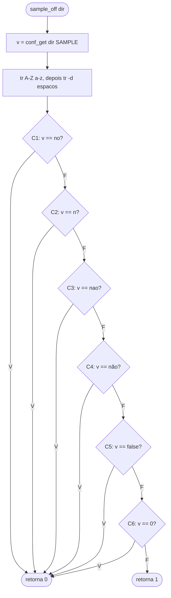
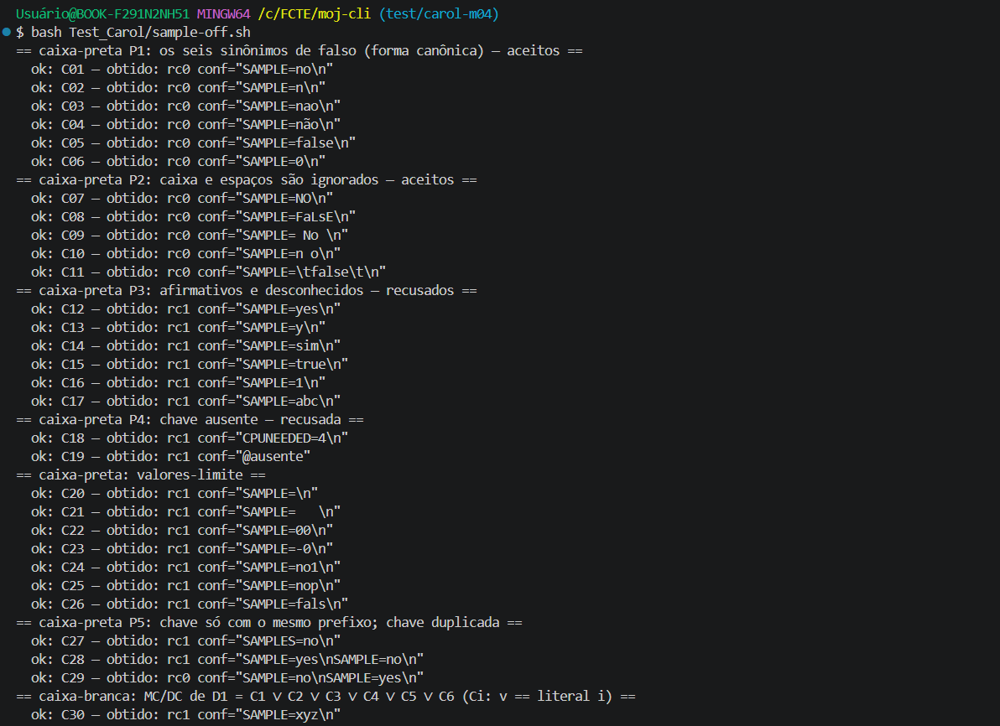
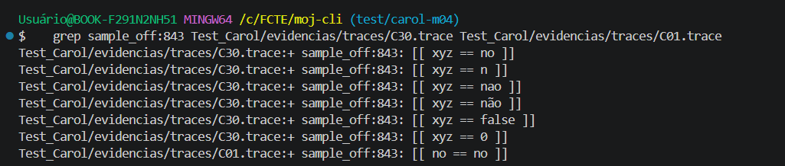
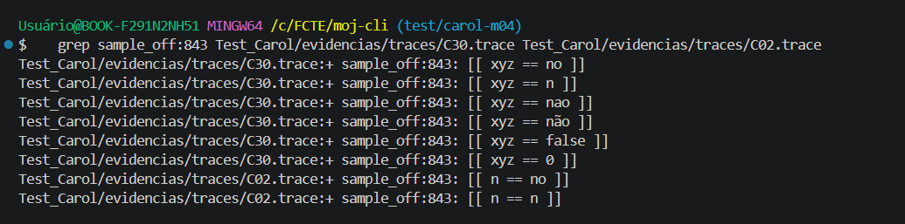
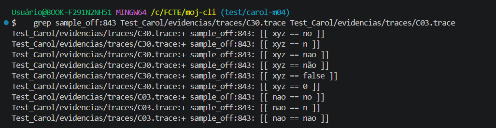
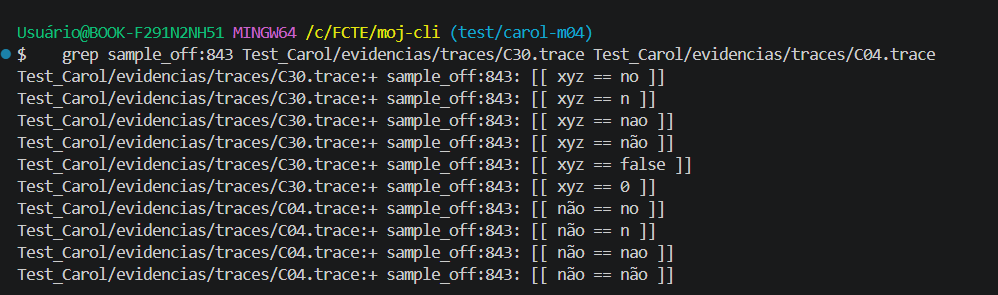
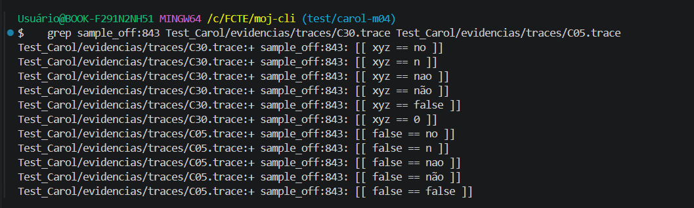
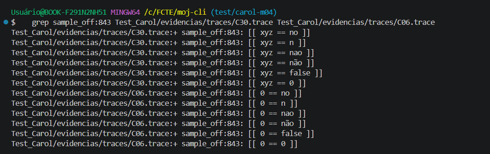
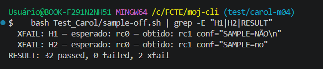

# M04 — `sample_off` (moj-cli) · Testes de Software G11 · Carol

## 1. Identificação

| Item | Valor |
|---|---|
| Método | M04 `sample_off`. Também exercita a função que ele chama, `conf_get`, e o `gate`, que o usa |
| Arquivo | `moj`: `sample_off` nas linhas 842–843 (`conf_get` na linha 370, `gate` logo depois de `sample_off`) |
| Commit | `<hash do git rev-parse --short HEAD>` (base: `716ce0c`, `master` do repositório) |
| Branch | `test/carol-m04` |
| Ferramentas | `<bash --version \| head -1>` · `<jq --version>` · `<sistema operacional: Git Bash no Windows / WSL Ubuntu>` |
| Data | `<AAAA-MM-DD da execução que gerou as evidências>` |
| Script | `Test_Carol/sample-off.sh`: teste de unidade, offline, com fixture em `mktemp -d` |

Para reproduzir, rode na raiz do `moj-cli`:

```bash
bash Test_Carol/sample-off.sh             # execução normal (exit 0 = nenhum caso C falhou)
bash Test_Carol/sample-off.sh --trace     # grava evidencias/traces/<ID>.trace (xtrace de cada caso)
```

O script carrega o `moj` com `MOJ_CLI_LIB_ONLY=1 source moj` (o mesmo jeito do `test/parallel-conf.sh`). Nesse modo o `moj` só define as funções. `MOJ_CONFIG_DIR` aponta para a fixture, e nenhuma configuração real da máquina é lida. O `moj` exige o `jq` para carregar, e o script confere isso logo no início.

## 2. Contrato

O contrato vem do comentário acima da função, da descrição da ficha do M04 e do jeito como o `gate` usa o resultado.

- **`sample_off`** (comentário acima da linha 842): *"<dir> — o conf declara SAMPLE=no: o problema NÃO tem exemplos (função, interativo, linguagem própria…). A MESMA regra do mojtools/statement-langs.sh (stmt_no_samples) e do editor web."*
- **Descrição da ficha:** interpreta os valores de `SAMPLE` que desativam exemplo, **ignorando caixa e espaços**. São seis sinônimos de falso: `no`, `n`, `nao`, `não`, `false` e `0`. O oráculo é o **código de saída**, não o stdout.
- **Retorno:** 0 quando o valor é um dos seis sinônimos (o problema não tem exemplos) e 1 em qualquer outro caso, inclusive chave ausente e conf ausente. A função não imprime nada.
- **Chamador:** o `gate` usa `sample_off`. Com ela V, o `gate` dispensa `tests/input/sample*` e avisa `SAMPLE=no`. Com ela F e sem nenhum `sample*`, o `gate` reprova com `sem exemplos`.
- **`conf_get`** (linha 370): lê a primeira ocorrência `CHAVE=valor` e tira aspas externas. Os casos de chave duplicada e de prefixo parecido (C27–C29) vêm daí.

Os dois defeitos da seção 6 se apoiam em "ignorando caixa e espaços" (H1) e em ler um `SAMPLE=no` que é a última linha do arquivo (H2). Ambos os requisitos são **leituras da ficha e do código**, e não de uma especificação formal do projeto.

## 3. Caixa-preta: partições e limites

Fixture criada em `$T = mktemp -d`:

| Pasta | Conteúdo |
|---|---|
| `p/` | só o arquivo `conf`, reescrito a cada caso (o conteúdo aparece na coluna `conf` da seção 5) |
| `g/` | pacote mínimo para o `gate`: `docs/enunciado.md`, `sols/good/a.c`, `.moj-id` e **nenhum** `tests/input/sample*` |

| Partição / limite | Classe | Casos |
|---|---|---|
| P1 os seis sinônimos de falso, na forma canônica | válida | C01–C06 |
| P2 caixa e espaços ignorados (`NO`, `FaLsE`, ` No `, `n o`, TAB) | válida | C07–C11 |
| P3 afirmativos e desconhecidos (`yes`, `y`, `sim`, `true`, `1`, `abc`) | inválida | C12–C17 |
| P4 chave ausente (conf sem `SAMPLE`; arquivo conf ausente) | inválida | C18, C19 |
| L1 vazio | limite | C20 |
| L2 só espaços | limite | C21 |
| L3 fronteira do `0`: `00` e `-0` | limite | C22, C23 |
| L4 quase-sinônimo: `no1`, `nop`, `fals` (pega comparação por prefixo) | limite | C24–C26 |
| P5 chave com o mesmo prefixo (`SAMPLES=no`) | inválida | C27 |
| P6 chave duplicada: vale a primeira | válida e inválida | C28, C29 |

Não há intervalo numérico relevante. A fronteira que importa é entre o `0` aceito e outras cifras (C22, C23).

## 4. Caixa-branca

### Decisões e condições

| Decisão | Linha | Expressão |
|---|---|---|
| **N1** | 842 | normalização, não é decisão: `v = conf_get … \| tr 'A-Z' 'a-z' \| tr -d '[:space:]'` |
| **D1** | 843 | `C1 ∨ C2 ∨ C3 ∨ C4 ∨ C5 ∨ C6`, com C1 = `v == no`, C2 = `v == n`, C3 = `v == nao`, C4 = `v == não`, C5 = `v == false`, C6 = `v == 0` |

A saída da função é o resultado de D1: não há `else`, o `return` é o próprio `[[ … ]]`.

Cobertura de decisão (V/F) de D1, com resultado real:

| Decisão | V | F |
|---|---|---|
| D1 | C01–C11, C29, C31 | C12–C28, C30, C32 |

A normalização N1 é exercitada pelos casos de caixa e de espaços (C07, C08, C09, C10, C11). O `conf_get` interno só recebe os casos de chave ausente, duplicada e prefixo (C18, C19, C27, C28, C29).

### Fluxo de `sample_off`



### MC/DC de D1

As seis condições comparam a **mesma variável** `v` com literais diferentes, então são mutuamente exclusivas. Isso limita os pares: o valor-base C30 (`xyz`) deixa as seis em F (D1 = F), e o literal de cada condição deixa só ela em V (D1 = V). Cada par muda **só uma condição** e a decisão muda junto.

| Par | Condição | C1 | C2 | C3 | C4 | C5 | C6 | D1 |
|---|---|---|---|---|---|---|---|---|
| C30 × **C01** | C1 | **V** | – | – | – | – | – | V |
| C30 × **C02** | C2 | F | **V** | – | – | – | – | V |
| C30 × **C03** | C3 | F | F | **V** | – | – | – | V |
| C30 × **C04** | C4 | F | F | F | **V** | – | – | V |
| C30 × **C05** | C5 | F | F | F | F | **V** | – | V |
| C30 × **C06** | C6 | F | F | F | F | F | **V** | V |
| **C30** (base) | todas | F | F | F | F | F | F | F |

"–" = não avaliada, por causa do curto-circuito do `||`. É MC/DC com mascaramento: em cada par, só a condição em estudo muda o resultado.

**Combinações inviáveis.** Qualquer combinação com duas condições V ao mesmo tempo é impossível, porque `v` não pode ser igual a dois literais diferentes. Por isso o conjunto factível tem 7 linhas (N+1 = 7), que são as da tabela. Nada fica de fora por falta de caso.

O xtrace mostra **cada condição** do OR em uma linha própria (`sample_off:843`), então a independência aparece direto no trace. Trechos de `evidencias/traces/`:

- **Base C30** (`xyz`): as seis condições são avaliadas e todas dão F:
  ```
  + sample_off:843: [[ xyz == no ]]
  + sample_off:843: [[ xyz == n ]]
  + sample_off:843: [[ xyz == nao ]]
  + sample_off:843: [[ xyz == não ]]
  + sample_off:843: [[ xyz == false ]]
  + sample_off:843: [[ xyz == 0 ]]
  ```
- **C03** (`nao`): C1 e C2 dão F e C3 dá V; C4 a C6 nem são avaliadas:
  ```
  + sample_off:843: [[ nao == no ]]
  + sample_off:843: [[ nao == n ]]
  + sample_off:843: [[ nao == nao ]]
  ```

## 5. Resultados

Execução de `<AAAA-MM-DD>` (`evidencias/saida-<AAAA-MM-DD>.txt`): **`RESULT: 32 passed, 0 failed, 2 xfail`**, exit 0.

| ID | conf | esperado | obtido | status | critério |
|---|---|---|---|---|---|
| C01 | `SAMPLE=no` | rc0 | rc0 | ok | P1; MC/DC C1 (par com C30) |
| C02 | `SAMPLE=n` | rc0 | rc0 | ok | P1; MC/DC C2 |
| C03 | `SAMPLE=nao` | rc0 | rc0 | ok | P1; MC/DC C3 |
| C04 | `SAMPLE=não` | rc0 | rc0 | ok | P1; MC/DC C4 |
| C05 | `SAMPLE=false` | rc0 | rc0 | ok | P1; MC/DC C5 |
| C06 | `SAMPLE=0` | rc0 | rc0 | ok | P1; MC/DC C6 |
| C07 | `SAMPLE=NO` | rc0 | rc0 | ok | P2: caixa (N1) |
| C08 | `SAMPLE=FaLsE` | rc0 | rc0 | ok | P2: caixa mista |
| C09 | `SAMPLE= No ` | rc0 | rc0 | ok | P2: espaços nas pontas e caixa |
| C10 | `SAMPLE=n o` | rc0 | rc0 | ok | P2: espaço interno some |
| C11 | `SAMPLE=<TAB>false<TAB>` | rc0 | rc0 | ok | P2: TAB conta como espaço |
| C12 | `SAMPLE=yes` | rc1 | rc1 | ok | P3 |
| C13 | `SAMPLE=y` | rc1 | rc1 | ok | P3 |
| C14 | `SAMPLE=sim` | rc1 | rc1 | ok | P3 |
| C15 | `SAMPLE=true` | rc1 | rc1 | ok | P3 |
| C16 | `SAMPLE=1` | rc1 | rc1 | ok | P3 |
| C17 | `SAMPLE=abc` | rc1 | rc1 | ok | P3 |
| C18 | conf sem `SAMPLE` | rc1 | rc1 | ok | P4 |
| C19 | arquivo conf ausente | rc1 | rc1 | ok | P4 |
| C20 | `SAMPLE=` | rc1 | rc1 | ok | L1: vazio |
| C21 | `SAMPLE=` + 3 espaços | rc1 | rc1 | ok | L2: só espaços |
| C22 | `SAMPLE=00` | rc1 | rc1 | ok | L3: fronteira do `0` |
| C23 | `SAMPLE=-0` | rc1 | rc1 | ok | L3 |
| C24 | `SAMPLE=no1` | rc1 | rc1 | ok | L4: quase `no` |
| C25 | `SAMPLE=nop` | rc1 | rc1 | ok | L4: prefixo de sinônimo |
| C26 | `SAMPLE=fals` | rc1 | rc1 | ok | L4: sinônimo truncado |
| C27 | `SAMPLES=no` | rc1 | rc1 | ok | P5: chave só com o mesmo prefixo |
| C28 | `SAMPLE=yes` e depois `SAMPLE=no` | rc1 | rc1 | ok | P6: vale a primeira |
| C29 | `SAMPLE=no` e depois `SAMPLE=yes` | rc0 | rc0 | ok | P6: vale a primeira |
| C30 | `SAMPLE=xyz` | rc1 | rc1 | ok | MC/DC: base (todas F) |
| C31 | gate com `SAMPLE=no` e sem `sample*` | gate rc0, avisa `SAMPLE=no` | rc0 | ok | D1 V com assert no efeito |
| C32 | gate com `SAMPLE=yes` e sem `sample*` | gate rc≠0, diz `sem exemplos` | rc1 | ok | D1 F com assert no efeito |
| H1 | `SAMPLE=NÃO` | rc0 | rc1 | XFAIL | defeito H1 |
| H2 | `SAMPLE=no` sem newline final | rc0 | rc1 | XFAIL | defeito H2 |

Confira os valores da coluna "obtido" com o arquivo `evidencias/saida-<data>.txt` antes de entregar.



### Traces dos pares MC/DC













## 6. Defeitos (XFAIL)

O oráculo é o requisito (seção 2), e não o código. Os dois casos falham hoje e não entram no exit code.

### H1: `NÃO` em maiúscula é recusado

- **Obtido:** com `SAMPLE=NÃO`, `sample_off` devolve rc1. Com `SAMPLE=não` e com `SAMPLE=Não`, devolve rc0.
- **Por que viola o requisito:** a ficha diz que a função ignora a caixa. O `tr 'A-Z' 'a-z'` só converte letras ASCII, então o `Ã` continua maiúsculo (`nÃo`) e não bate com `não`. Isso não depende do locale: o intervalo `A-Z` é só ASCII.
- **Como acontece em produção:** um autor que escreve `SAMPLE=NÃO` no `conf` espera que o problema fique sem exemplos. O `gate` então reprova com `sem exemplos`, mesmo com `SAMPLE` declarado.
- **Correção sugerida (não aplicada):** aceitar também a forma que sai da normalização. O MC/DC passaria a ter uma sétima condição.

```diff
--- a/moj
+++ b/moj
@@ sample_off
-  [[ "$v" == no || "$v" == n || "$v" == nao || "$v" == não || "$v" == false || "$v" == 0 ]]; }
+  [[ "$v" == no || "$v" == n || "$v" == nao || "$v" == não || "$v" == nÃo || "$v" == false || "$v" == 0 ]]; }
```

  Outra opção é trocar o `tr 'A-Z' 'a-z'` por `${v,,}`, mas ela depende do locale: foi testada e converte `Ã` em `ã` com `LC_ALL=C.UTF-8`, e não converte com `LC_ALL=C`.



### H2: `SAMPLE=no` na última linha, sem newline final, não é lido

- **Obtido:** com o conf `SAMPLE=no` (sem `\n` no fim), `sample_off` devolve rc1. A causa está no `conf_get`: `read -r` devolve falha quando chega ao fim do arquivo sem newline, e o laço `while` não executa para essa última linha.
- **Por que viola o requisito:** o valor está no arquivo e é um dos seis sinônimos. A ficha também pede que o comportamento da última linha seja confirmado no código, e aqui ele foi.
- **Como acontece em produção:** um `conf` editado à mão ou por um editor que não coloca newline no fim, com `SAMPLE` na última linha.
- **Correção sugerida (não aplicada), no `conf_get` (linha 370):**

```diff
--- a/moj
+++ b/moj
@@ conf_get
-  while IFS= read -r line; do
+  while IFS= read -r line || [[ -n "$line" ]]; do
```

  Testei essa alteração numa cópia da função: a chave da última linha passa a ser lida e o caso normal continua igual. Este defeito é do **M03 (`conf_get`)**, então combine com quem fez o M03 para o relatório dele dizer a mesma coisa.


## 7. Lacunas e limitações

- **Cobertura de linhas (kcov):** não foi medida. A função tem duas linhas (842–843), e a linha 843 concentra as seis condições, então o percentual de linhas diria pouco. A cobertura de decisão e o MC/DC vêm dos traces e dos pares da seção 4.
- **`conf_get` fora do foco:** só foram exercitados os ramos que chegam por `sample_off`. Valor com aspas, `conf_set` e o resto do arquivo `moj` não são alvo deste teste.
- **Valores com aspas** (`SAMPLE="no"`): não há caso, porque ficaram fora da análise combinada deste método.
- **Locale:** os casos foram escritos sem depender de locale. O H1 não muda com ele.
- **Script do repo, não o artefato:** os testes rodam o `moj` do repo, e não o `dist/moj` que o `mkdist.sh` gera.
- **Caminhos temporários nos traces:** os traces trazem caminhos do `mktemp` (`/tmp/tmp.XXXX`), que mudam a cada execução.

## 8. Uso de Inteligência Artificial

- **Ferramenta:** Claude (chat).
- **O que foi feito com apoio da IA:** a análise do código de `sample_off` e `conf_get`, a derivação das partições, dos valores-limite e dos pares MC/DC, a escrita do script `sample-off.sh` e o rascunho deste relatório.
