# M10 — `id_arg` (moj-cli) · Testes de Software G11 · Eduardo

## 1. Identificação

| Item | Valor |
|---|---|
| Método | M10 `id_arg`. Também exercita as funções que ele chama: `resolve_id` e `pkg_root` |
| Arquivo | `moj`: `pkg_root` nas linhas 1453–1458, `resolve_id` nas linhas 1462–1471, `id_arg` nas linhas 1475–1480 |
| Commit | `716ce0c` (`master`, sincronizado com `upstream/master`: `git rev-list --count master..upstream/master` = 0) |
| Branch | `test/eduardo-m10` |
| Ferramentas | GNU bash 5.3.20(1)-release · jq-1.8.2 · kcov 43 · ImageMagick 7.1.2-34 · Arch Linux, kernel 6.18.57-2-lts |
| Data | 2026-10-23 |
| Script | `Test_Eduardo/id-arg.sh`: teste de unidade, offline, com fixture em `mktemp -d` |

Para reproduzir, rode na raiz do `moj-cli`:

```bash
bash Test_Eduardo/id-arg.sh                                   # execução normal (exit 0 = nenhum caso C falhou)
bash Test_Eduardo/id-arg.sh --trace                           # grava evidencias/traces/<ID>.trace (xtrace)
kcov --include-path="$PWD/moj" Test_Eduardo/evidencias/cobertura ./Test_Eduardo/id-arg.sh   # cobertura de linhas
```

O script carrega o `moj` com `MOJ_CLI_LIB_ONLY=1 source moj` (o mesmo jeito do `test/parallel-conf.sh`). Nesse modo o `moj` só define as funções. `MOJ_CONFIG_DIR` aponta para a fixture, e nenhuma configuração real da máquina é lida.

## 2. Contrato

O contrato vem dos comentários do código, da documentação (`CLAUDE.md` do upstream e cabeçalho do `moj`) e do jeito como os chamadores usam a função.

- **`id_arg`** (comentário acima da linha 1475): *"id_arg <regex-do-que-NÃO-é-id> "$@" -> define ID e IDSHIFT (1 = o 1º argumento ERA o id; o chamador faz o shift). O id é IMPLÍCITO (vem da pasta) quando não há argumento, quando o 1º é uma opção (-…) ou quando ele casa a regex E estamos numa pasta de problema (ex.: `moj public on`, `moj restore <sha>`)."*
- **`resolve_id`** (comentário acima da linha 1462): *"resolve_id [arg] -> <org>#<prob>. Vazio = o da pasta do problema; com '#' = ele mesmo; pasta clonada = o dela; nome SEM a org = <org da pasta atual>#nome."*
- **`pkg_root`** (comentário acima da linha 1453): devolve a pasta do problema. É a própria pasta ou a primeira acima dela que tem `.moj-id` ("como o git acha o .git").
- **Pós-condição de `id_arg`**: `ID` tem a forma `<org>#<prob>`. Senão, a função chama `die "id inválido: … (esperado <org>#<prob>)"`. O cabeçalho do `moj` diz que *"ORG = quem edita. É o prefixo do id <org>#<prob>"*. Por isso este relatório lê `<org>` e `<prob>` como **não vazios**. As hipóteses H1–H4 se apoiam nessa leitura.
- **Chamadores** (exemplos): `cmd_public` usa `id_arg '^(on|off)$'`, `cmd_log` usa `id_arg '^[0-9a-f]{7,40}$'`, `cmd_download` usa `id_arg '\.(tar\.gz|tgz|tar)$'`, e `cmd_publish`/`cmd_validate` usam `id_arg ''`. Depois da chamada, todos fazem `shift "$IDSHIFT"`.

## 3. Caixa-preta: partições e limites

Fixture criada em `$T = mktemp -d`, com caminho físico (`pwd -P`, porque `pkg_root` usa `pwd -P`):

| Pasta | `.moj-id` |
|---|---|
| `pkg/` | `{"id":"org#p1","repo":"org"}` |
| `pkg/sub/` | nenhum (subpasta do pacote) |
| `pkg2/` | `{"id":"org2#p2","repo":"org2"}` |
| `semid/` | `{"repo":"org3"}` (sem `id`) |
| `semrepo/` | `{"id":"x#y"}` (sem `repo`) |
| `fora/` | nenhum, e nenhum acima. O script confere essa pré-condição: aborta se `pkg_root` achar um pacote a partir de `fora/` |

`R` = `^(on|off)$` (a regex do `moj public`). `''` = regex vazia.

| Partição / limite | Classe | Casos |
|---|---|---|
| P1 sem argumento, dentro do pacote | válida | C01 |
| P2 sem argumento, em subpasta do pacote | válida | C02 |
| P3 sem argumento, fora de pacote | inválida | C03 |
| P4 1º argumento é opção (`-…`) | válida | C04 |
| L1 limite de P4: `-` sozinho | limite | C05 |
| L2 limite de P4: hífen fora da 1ª posição (`a-b`) | limite | C06 |
| P5 nome curto, dentro do pacote | válida | C07 |
| P6 id completo `org#prob` (fora do pacote) | válida | C08 |
| P7 nome curto, fora de pacote | inválida | C09 |
| P8 caminho de pasta clonada | válida | C10 |
| P9 palavra livre (casa a regex) dentro do pacote | válida | C11 |
| P10 palavra livre fora de pacote | inválida | C14 |
| L3 limite da regex: caixa (`ON`) | limite | C15 |
| L4 limite da regex: âncora (`onn`) | limite | C16 |
| P11 dois argumentos (só o 1º decide) | válida | C17 |
| P12 `.moj-id` sem `id` (implícito) | inválida | C18 |
| P13 pasta clonada cujo `.moj-id` não tem `id` | inválida | C19 |

## 4. Caixa-branca

### Decisões e condições

| Decisão | Linha | Expressão |
|---|---|---|
| **D1** | 1476 | `A ∨ B ∨ (C ∧ D ∧ E)`. A = `$# -eq 0`, B = `"$1" == -*`, C = `-n "$free"`, D = `"$1" =~ $free`, E = `pkg_root` ok |
| **D2** | 1477 | `ID="$(resolve_id)" \|\| exit 1`: o `resolve_id` implícito deu certo? |
| **D3** | 1478 | `ID="$(resolve_id "$1")" \|\| exit 1`: o `resolve_id` explícito deu certo? |
| **D4** | 1479 | `[[ "$ID" == *#* ]] \|\| die …`: `ID` contém `#`? |

Cobertura de decisão (V/F), com resultado real:

| Decisão | V | F |
|---|---|---|
| D1 | C01, C02, C03, C04, C05, C11, C18 | C06–C10, C12–C17, C19 |
| D2 | C01, C02, C04, C05, C11, C18 | C03 |
| D3 | C06–C08, C10, C12, C13, C15–C17, C19 | C09, C14 |
| D4 | todos os casos com rc0 | C18, C19 |

**Curto-circuito.** Com A=V, o bash não avalia B, C, D nem E. Com C=F, ele não avalia D nem E. Isso **mascara** D e E nos pares de A e de B. É aceitável no MC/DC com mascaramento: nesses pares, só a condição em estudo muda o resultado.

**O que não é factível.** Em `pkg_root`, o termo `-z "$d"` (linha 1456) nunca fica V. `d` vem de `pwd -P` ou de `dirname`, e nenhum dos dois devolve string vazia. Esse termo não entra nos pares deste método.

### Fluxo de `id_arg`

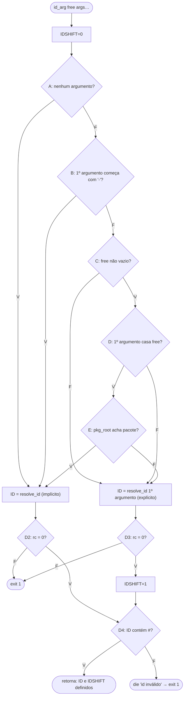

### MC/DC de D1

| Par | Condição | A | B | C | D | E | D1 | Ramo (linha) |
|---|---|---|---|---|---|---|---|---|
| **C01** × C07 | A | **V** | – | – | – | – | V | 1477 |
| C01 × **C07** | A | **F** | F | F | – | – | F | 1478 |
| **C04** × C07 | B | F | **V** | – | – | – | V | 1477 |
| C04 × **C07** | B | F | **F** | F | – | – | F | 1478 |
| **C11** × C12 | C | F | F | **V** | V | V | V | 1477 |
| C11 × **C12** | C | F | F | **F** | – | – | F | 1478 |
| C11 × **C13** | D | F | F | V | **F** | – | F | 1478 |
| C11 × **C14** | E | F | F | V | V | **F** | F | 1478 |

"–" = não avaliado (curto-circuito). Em cada par, só a condição em negrito muda, e o ramo também muda.

O xtrace mostra **cada termo** do `[[ … ]] || [[ … ]] || { … }` numa linha própria (`id_arg:1476`). Assim, a independência aparece direto no trace, e não só no desenho dos dados. Trechos de `evidencias/traces/`:

- **A** (C01 × C07): em C01, `id_arg:1476: [[ 0 -eq 0 ]]` e logo `id_arg:1477: ID=org#p1`. Em C07, `[[ 1 -eq 0 ]]`, `[[ x == -* ]]`, `[[ -n '' ]]` e então `id_arg:1478: ID=org#x`.
- **B** (C04 × C07): em C04, `[[ 1 -eq 0 ]]`, `[[ -x == -* ]]` e então `id_arg:1477`. Em C07, `[[ x == -* ]]` dá F e o fluxo segue como acima.
- **C** (C11 × C12): em C11, `[[ -n ^(on|off)$ ]]`. Em C12, `[[ -n '' ]]` e então `id_arg:1478: ID=org#on`.
- **D** (C11 × C13): em C11, `[[ on =~ ^(on|off)$ ]]` e então `pkg_root`. Em C13, `[[ foo =~ ^(on|off)$ ]]` e então `id_arg:1478` direto, sem chamar `pkg_root`.
- **E** (C11 × C14): em C11, `id_arg:1476: pkg_root` → `pkg_root:1455: return 0` → `id_arg:1477`. Em C14, `pkg_root:1456: return 1` → `id_arg:1478: ID=` → `exit 1`.

## 5. Resultados

Execução de 2026-10-23 (`evidencias/saida-2026-10-23.txt`): **`RESULT: 19 passed, 0 failed, 4 xfail`**, exit 0. A execução sob kcov deu o mesmo resultado.

| ID | dir | free | args | esperado | obtido | status | critério |
|---|---|---|---|---|---|---|---|
| C01 | pkg | '' | (nenhum) | rc0, `org#p1\|0` | rc0, `org#p1\|0` | ok | P1; MC/DC A=V |
| C02 | pkg/sub | '' | (nenhum) | rc0, `org#p1\|0` | rc0, `org#p1\|0` | ok | P2: sobe 1 nível até o pacote |
| C03 | fora | '' | (nenhum) | rc1, "falta o <id>" | rc1, `moj: falta o <id>: rode dentro da pasta de um problema …` | ok | P3: implícito sem pacote |
| C04 | pkg | '' | `-x` | rc0, `org#p1\|0` | rc0, `org#p1\|0` | ok | P4; MC/DC B=V |
| C05 | pkg | '' | `-` | rc0, `org#p1\|0` | rc0, `org#p1\|0` | ok | L1: `-` sozinho conta como opção |
| C06 | pkg | '' | `a-b` | rc0, `org#a-b\|1` | rc0, `org#a-b\|1` | ok | L2: hífen fora da 1ª posição |
| C07 | pkg | '' | `x` | rc0, `org#x\|1` | rc0, `org#x\|1` | ok | P5; par de A (C01) e de B (C04) |
| C08 | fora | '' | `org#p9` | rc0, `org#p9\|1` | rc0, `org#p9\|1` | ok | P6: id completo não depende da pasta |
| C09 | fora | '' | `x` | rc1, "não diz a org" | rc1, `moj: 'x' não diz a org: use <org>#x …` | ok | P7: nome curto sem pacote |
| C10 | fora | '' | `../pkg2` | rc0, `org2#p2\|1` | rc0, `org2#p2\|1` | ok | P8: caminho de pasta clonada |
| C11 | pkg | R | `on` | rc0, `org#p1\|0` | rc0, `org#p1\|0` | ok | P9; MC/DC base C=D=E=V |
| C12 | pkg | '' | `on` | rc0, `org#on\|1` | rc0, `org#on\|1` | ok | MC/DC C=F (par com C11) |
| C13 | pkg | R | `foo` | rc0, `org#foo\|1` | rc0, `org#foo\|1` | ok | MC/DC D=F (par com C11) |
| C14 | fora | R | `on` | rc1, "não diz a org" | rc1, `moj: 'on' não diz a org: use <org>#on …` | ok | P10; MC/DC E=F (par com C11) |
| C15 | pkg | R | `ON` | rc0, `org#ON\|1` | rc0, `org#ON\|1` | ok | L3: caixa da regex |
| C16 | pkg | R | `onn` | rc0, `org#onn\|1` | rc0, `org#onn\|1` | ok | L4: âncora da regex |
| C17 | pkg | '' | `org#p9 on` | rc0, `org#p9\|1` | rc0, `org#p9\|1` | ok | P11: com 2 argumentos, só o 1º decide |
| C18 | semid | '' | (nenhum) | rc1, "id inválido" | rc1, `moj: id inválido: '' (esperado <org>#<prob>)` | ok | P12; D4=F (implícito) |
| C19 | fora | '' | `../semid` | rc1, "id inválido" | rc1, `moj: id inválido: '' (esperado <org>#<prob>)` | ok | P13; D4=F (explícito) |
| H1 | fora | '' | `#` | rc1, "id inválido" | rc0, `#\|1` | XFAIL | a validação só confere se há `#` |
| H2 | fora | '' | `org#` | rc1, "id inválido" | rc0, `org#\|1` | XFAIL | prob vazio |
| H3 | fora | '' | `#p` | rc1, "id inválido" | rc0, `#p\|1` | XFAIL | org vazia |
| H4 | semrepo | '' | `foo` | rc1 | rc0, `#foo\|1` | XFAIL | `resolve_id` monta `#foo` quando o `.moj-id` não tem `repo` |

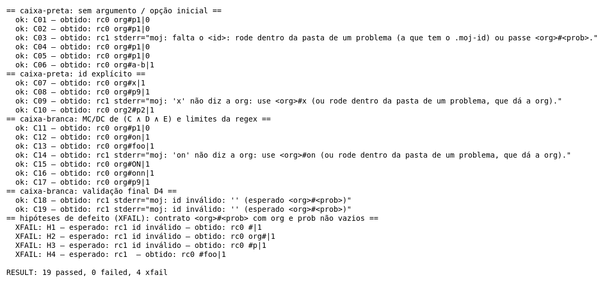

### Traces dos pares MC/DC

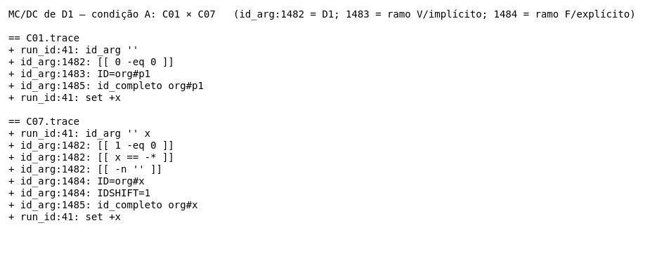

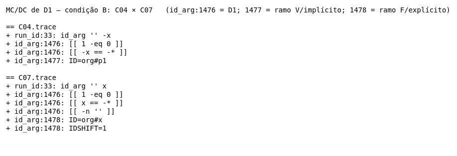

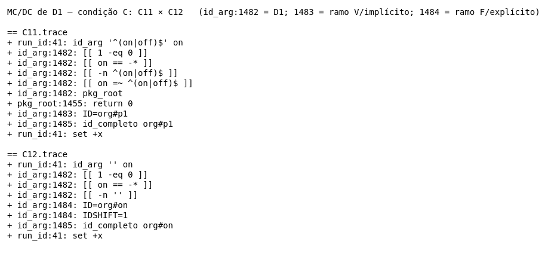

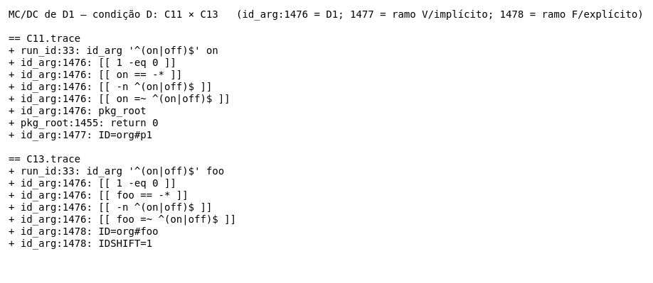

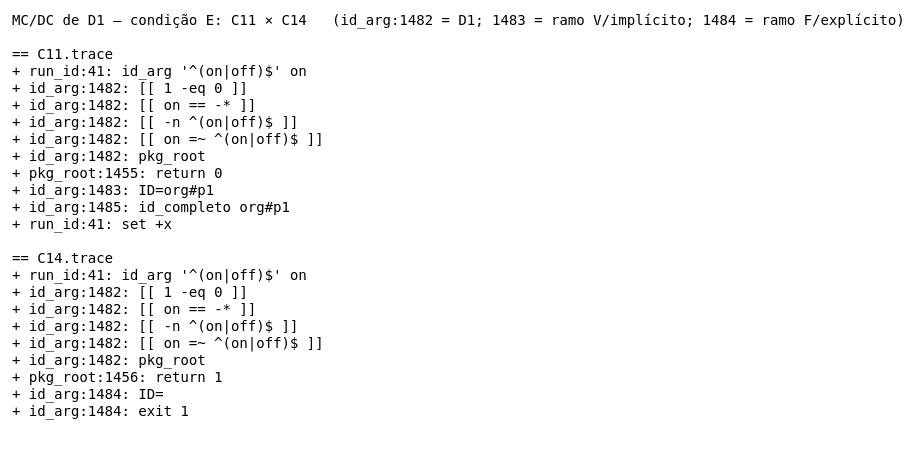

### Cobertura de linhas (kcov)

Comando: `kcov --include-path="$PWD/moj" Test_Eduardo/evidencias/cobertura ./Test_Eduardo/id-arg.sh`. O kcov roda **o script** (executável, com shebang `#!/bin/bash`), e não `bash <script>`. Se rodar `bash <script>`, ele mede o binário `/usr/bin/bash` e o relatório sai vazio. O relatório fica em `evidencias/cobertura/id-arg.sh.7f1210668999291f/` (`coverage.json`, `cobertura.xml`, `index.html`). Abra o `index.html` no navegador para ver o HTML.

Este relatório considera **só** as linhas de `pkg_root`, `resolve_id` e `id_arg` (1453–1480). O percentual global do arquivo `moj` não interessa aqui, porque o resto do arquivo não é alvo deste teste.

| Função | Linhas que o kcov instrumentou | Cobertas | Não cobertas |
|---|---|---|---|
| `pkg_root` | 1454, 1455, 1456, 1457, 1458 | 1454–1457 | 1458 (`done; }`) |
| `resolve_id` | 1463, 1464, 1465, 1467, 1468, 1469, 1470 | todas | — |
| `id_arg` | 1476, 1477, 1478, 1479 | todas | — |
| **Total** | **16** | **15** | **1** → 15/16 = 93,75% das linhas instrumentadas do trecho |

- **Linha 1458 (`done; }`), 0 hits.** O laço é `while :`, que nunca termina pela condição. Ele só sai por `return 0` (linha 1455) ou `return 1` (linha 1456). Por isso a linha `done` não tem comando que possa executar. Nenhuma entrada a cobre. É artefato da instrumentação, não lacuna dos casos.
- **Linhas 1453, 1462 e 1475 não foram instrumentadas.** São as linhas `nome(){ …`, e o kcov as trata como definição de função. Mesmo assim, elas têm comandos (`local d; d="$(…)"`, `local a=… r`, `local free="$1"; shift; IDSHIFT=0`). O xtrace mostra que esses comandos rodaram, por exemplo `pkg_root:1453: local d` e `id_arg:1475: IDSHIFT=0` em `traces/C01.trace`. Essas linhas ficam fora da conta de 16.
- As linhas 1466 (`fi`), 1471 e 1480 (`}`) e os comentários também não são instrumentados.

**Atenção:** o kcov mede **linha executada**, não decisão nem MC/DC. A linha 1476 tem as 5 condições de D1, e ela conta como "coberta" com qualquer um dos casos. A cobertura de decisão e a de MC/DC deste relatório vêm dos traces e dos pares da seção 4, não do kcov.

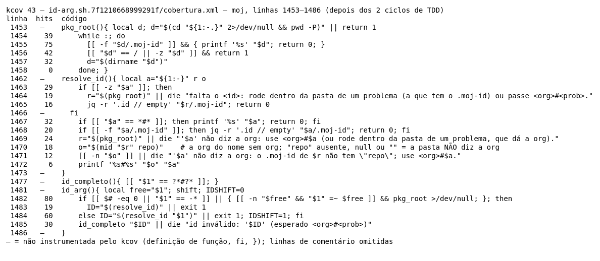

*Renderização via ImageMagick dos dados do relatório do kcov (moj.\*.js, linhas 1453–1480); não é captura de tela.*

## 6. Defeitos e hipóteses (XFAIL)

O oráculo é o contrato `<org>#<prob>` com `org` e `prob` não vazios (seção 2). Os quatro casos falham hoje, como a hipótese previa. Eles não entram no exit code.

### H1, H2 e H3: a validação final só confere se há `#`

- **Obtido:** `moj … '#'` dá `ID='#'`, `moj … 'org#'` dá `ID='org#'` e `moj … '#p'` dá `ID='#p'`, todos com rc0 e IDSHIFT=1.
- **Por que viola o contrato:** o `die` da linha 1479 promete `(esperado <org>#<prob>)`, mas `[[ "$ID" == *#* ]]` aceita org vazia, prob vazio ou os dois vazios.
- **Como acontece em produção:** um erro de digitação como `moj publish org#` ou `moj public '#p' on`. O `resolve_id` devolve o argumento sem mudança (linha 1467, "com '#' = ele mesmo"), e o `id_arg` aceita. O comando segue para a API com um id malformado. Este teste é offline e não verificou como o servidor responde.
- **Correção sugerida (não aplicada):**

```diff
--- a/moj
+++ b/moj
@@ id_arg
-  [[ "$ID" == *#* ]] || die "id inválido: '$ID' (esperado <org>#<prob>)"
+  [[ "$ID" == ?*#?* ]] || die "id inválido: '$ID' (esperado <org>#<prob>)"
```

O padrão `?*#?*` exige pelo menos 1 caractere antes e 1 depois de um `#`. Ele ainda aceita ids com mais de um `#` (por exemplo `a#b#c`). O contrato não diz nada sobre esse caso, e ele não foi testado.


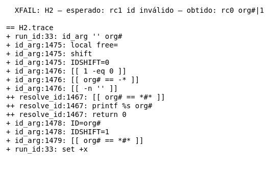

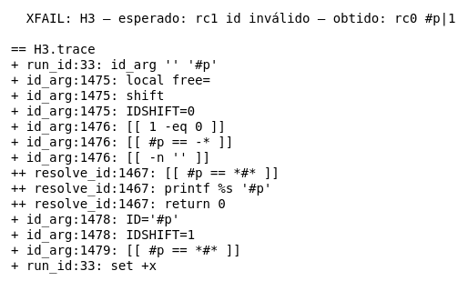

### H4: `resolve_id` monta `#foo` quando o `.moj-id` não tem `repo`

- **Obtido:** dentro de `semrepo/` (`.moj-id` = `{"id":"x#y"}`), `id_arg '' foo` dá rc0 e `ID='#foo'`. O trace mostra `resolve_id:1470: printf %s#%s '' foo` e depois `id_arg:1479: [[ #foo == *#* ]]`, que dá V.
- **Por que viola o contrato:** "nome SEM a org = <org da pasta atual>#nome". Aqui a pasta não diz a org, e o resultado tem org vazia. Era o caso de chamar o mesmo `die "… não diz a org"` da linha 1469.
- **Como acontece em produção:** um `.moj-id` sem o campo `repo`. Pode ser um `.moj-id` escrito à mão, de versão antiga ou editado. O `jq -r '.repo // empty'` devolve string vazia, e o `printf` monta `#<nome>` sem reclamar.
- **Correção sugerida (não aplicada):** a correção de H1–H3 já faz o `id_arg` barrar `#foo`. A correção na origem fica em `resolve_id`:

```diff
--- a/moj
+++ b/moj
@@ resolve_id
   r="$(pkg_root)" || die "'$a' não diz a org: use <org>#$a (ou rode dentro da pasta de um problema, que dá a org)."
-  printf '%s#%s' "$(jq -r '.repo // empty' "$r/.moj-id")" "$a"
+  local o; o="$(jq -r '.repo // empty' "$r/.moj-id")"
+  [[ -n "$o" ]] || die "'$a' não diz a org: o .moj-id de $r não tem \"repo\"; use <org>#$a."
+  printf '%s#%s' "$o" "$a"
```

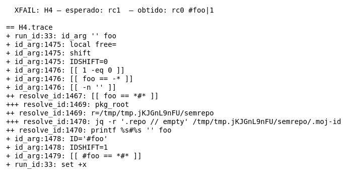

## 7. Lacunas e limitações

- **Condições dentro do `jq`.** O xtrace não enxerga o que acontece dentro de `jq -r '.id // empty'` e `jq -r '.repo // empty'`. Os testes cobrem campo presente (C01, C07) e campo ausente (C18, H4). Não cobrem `null` explícito, string vazia, tipo errado nem JSON quebrado.
- **Comandos nas linhas de definição de função.** O kcov não instrumenta as linhas 1453, 1462 e 1475, embora elas tenham comandos. Quem mostra que esses comandos rodaram é o xtrace (seção 5).
- **`pkg_root` com argumento.** O ramo em que `cd "${1:-.}"` falha (`|| return 1` na linha 1453) não foi exercitado. O `id_arg` sempre chama `pkg_root` sem argumento.
- **`-z "$d"` na linha 1456.** Esse termo não fica V (seção 4).
- **Script do repo, não o artefato.** Os testes rodam o `moj` do repo. O `CLAUDE.md` do upstream manda testar também o `dist/moj` gerado pelo `mkdist.sh`. Isso não foi feito aqui. As funções testadas não dependem da `lib/core.sh` embutida, a não ser pelo `die`.
- **Ids com mais de um `#`, espaços ou caracteres especiais.** Não há caso para eles, porque estão fora da análise combinada.
- **Caminhos temporários nos traces.** Os traces trazem caminhos do `mktemp` (`/tmp/tmp.XXXX`), que mudam a cada execução.
- **Cobertura.** O kcov mede só linha (ver a ressalva na seção 5). Não há medida automática de decisão nem de MC/DC.

## 8. Uso de Inteligência Artificial

- **Ferramentas:** Claude (chat) e Claude Code (agente no terminal).
- **Análise e derivação dos casos (Claude, no chat):** a análise do código de `id_arg`, `resolve_id` e `pkg_root` e a derivação dos casos de teste. Isso inclui as partições, os valores limite, os pares MC/DC e as hipóteses de defeito H1–H4.
- **Implementação e evidências (Claude Code):** a escrita e a execução do script `id-arg.sh`. A geração das evidências: saída, traces, imagens e cobertura com o kcov. A redação deste relatório, incluindo as correções sugeridas em diff.
- **Revisão e decisões (Eduardo):** a revisão do material e as decisões sobre os oráculos e sobre o que entra neste relatório.
- **Autorização:** a professora da disciplina autorizou o uso de IA neste trabalho.
