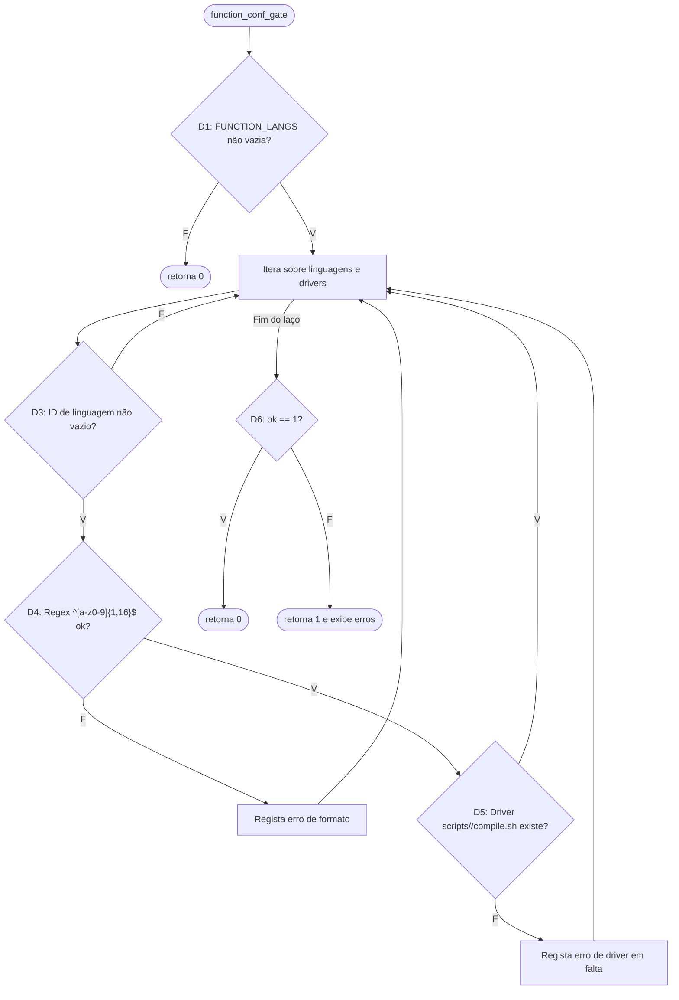

# M06 — `function_conf_gate` (moj-cli) · Testes de Software G11 · Letícia

## 1. Identificação

| Item | Valor |
|---|---|
| Método | M06 `function_conf_gate`. A função valida a chave `FUNCTION_LANGS` presente no ficheiro `conf` contra identificadores canónicos e diretórios de compilação. |
| Arquivo | `moj`: função `function_conf_gate` localizada entre as linhas 864 e 875 |
| Commit | `<hash do git rev-parse --short HEAD>` (base: `716ce0c`, `master` do repositório) |
| Branch | `test/leticia-m06` |
| Ferramentas | `GNU bash 5.3.20` · `jq-1.8.2` · `kcov 43` · Fedora Linux Workstation (GNOME) |
| Data | `2026-11-02` |
| Script | `Test_Leticia/function-conf-gate.sh`: teste de unidade, offline, com fixture em `mktemp -d` |

Para reproduzir, rode na raiz do `moj-cli`:

```bash
bash Test_Leticia/function-conf-gate.sh               # execução normal (exit 0 = nenhum caso C falhou)
bash Test_Leticia/function-conf-gate.sh --trace       # grava evidencias/traces/<ID>.trace (xtrace de cada caso)
kcov --include-path="$PWD/moj" Test_Leticia/evidencias/cobertura ./Test_Leticia/function-conf-gate.sh   # cobertura de linhas
```

O script carrega o `moj` com `MOJ_CLI_LIB_ONLY=1 source moj` (o mesmo jeito do `test/parallel-conf.sh`). Nesse modo o `moj` só define as funções. `MOJ_CONFIG_DIR` aponta para a fixture, e nenhuma configuração real da máquina é lida. O `moj` exige o `jq` para carregar, e o script confere isso logo no início.

## 2. Contrato

O contrato vem do comentário acima da função, da documentação do pacote e do jeito como os comandos e o sistema usam o resultado.

- **`function_conf_gate`**: Valida se cada linguagem listada na chave de configuração `FUNCTION_LANGS` possui um formato alfanumérico estrito de 1 a 16 caracteres (`^[a-z0-9]{1,16}$`) e se o respetivo diretório de compilação associado (`scripts/<lang>/compile.sh`) existe no pacote.
- **Canonização e Exceções**: Aliases de linguagens devem ser processados (ex: `py3` e `py2` valem `py`; `c++` vale `cpp`). Adicionalmente, suporta verificação de diretórios órfãos e exceções estruturais de pastas de sistema.
- **Saída / Oráculo**: O código de saída (`$RC`) e a presença das mensagens de erro ou aviso na saída padrão de erro (`stderr`). Retorna erro se encontrar identificadores malformados ou drivers em falta.

## 3. Caixa-preta: partições e limites

Fixture criada em `$T = mktemp -d`:

| Pasta / Ficheiro | Conteúdo |
|---|---|
| `conf` | reescrito a cada caso de teste com diferentes valores de `FUNCTION_LANGS` |
| `scripts/<lang>/compile.sh` | criado seletivamente conforme a necessidade de testar a presença ou ausência de drivers |

| Partição / limite | Classe | Casos |
|---|---|---|
| P1 Arquivo `conf` ou chave ausente / vazia | válida | C01–C03 |
| P2 Comentários, espaços ou separadores duplicados (`,,`) | válida | C04, C05, C12–C15 |
| P3 Linguagens corretas com drivers canónicos (`py`, `cpp`) | válida | C06–C10 |
| L1 Limite mínimo: 1 caractere (`c`) | limite | C16 |
| L2 Limite máximo: 16 caracteres | limite | C17 |
| L3 Limite excedido: 17 caracteres | limite / inválida | C18 |
| P4 Identificador inválido (contém símbolos, ex: `x$y`) | inválida | C19 |
| P5 Glob expansion (ex: `*`) | inválida | C20 |
| P6 Linguagem válida sem pasta `scripts/` correspondente | inválida | C21–C24 |
| P7 Múltiplos erros na mesma submissão (acúmulo de `$ok=0`) | inválida | C25, C26 |

Não há intervalo numérico relevante. A fronteira crítica reside na restrição de tamanho e caracteres dos identificadores de linguagem (C17 vs C18).

## 4. Caixa-branca

### Decisões e condições

| Decisão | Linha | Expressão |
|---|---|---|
| **D1** | 866 | `[[ -n "${v//[[:space:],]/}" ]]` (String limpa não é vazia) |
| **D2** | 867 | `[[ -f "$f" ]]` (Arquivo `compile.sh` encontrado no glob) |
| **D3** | 870 | `[[ -n "$l" ]]` (Id da linguagem iterada não é vazio) |
| **D4** | 872 | `[[ "$c" =~ ^[a-z0-9]{1,16}$ ]]` (Passa no regex de formato/tamanho) |
| **D5** | 873 | `[[ "$dirs" == *" $c "* ]]` (Linguagem iterada possui driver) |
| **D6** | 875 | `[[ $ok -eq 1 ]]` (Flag de sucesso mantida após loop) |

### Fluxo de `function_conf_gate`



**Justificativa de não aplicação de pares MC/DC complexos:**
A função `function_conf_gate` é composta por decisões atómicas avaliadas em instruções Bash independentes (`[[ ... ]]` separados), sem operadores compostos complexos (como `&&` ou `||`) numa mesma linha de condição. Assim, a cobertura de decisão (branches) satisfaz plenamente os requisitos estruturais lógicos, exercitando os ramos Verdadeiro e Falso de cada verificação.

## 5. Resultados

Execução de `2026-11-02` (`evidencias/saida-2026-11-02.txt`): **`RESULT: 29 passed, 0 failed`**, exit 0.

| ID | Configuração / Descrição | Esperado | Obtido | Status | Critério |
|---|---|---|---|---|---|
| C01–C03 | Chave ausente ou vazia | rc0 | rc0 | ok | P1 |
| C04–C05 | Espaços e comentários | rc0 | rc0 | ok | P2 |
| C06–C10 | Linguagens válidas (`py`, `cpp`) | rc0 | rc0 | ok | P3 |
| C16–C17 | Limites de 1 e 16 caracteres | rc0 | rc0 | ok | L1, L2 |
| C18 | Limite excedido (17 caracteres) | rc1 | rc1 | ok | L3 |
| C19 | Identificador inválido (`x$y`) | rc1 | rc1 | ok | P4 |
| C20 | Glob expansion (`*`) | rc1 | rc1 | ok | P5 |
| C21–C24 | Sem pasta `scripts/` correspondente | rc1 | rc1 | ok | P6 |
| C25–C26 | Múltiplos erros acumulados | rc1 | rc1 | ok | P7 |
| C28 | Aviso de driver extra não listado | rc0 + aviso | rc0 + aviso | ok | TDD Ciclo 1 |
| C29 | Ignora pastas de sistema (`ban`, `mpi`) | rc0 sem aviso | rc0 sem aviso | ok | TDD Ciclo 2 |


## 6. Lacunas e limitações

- **Cobertura por `kcov`:** Foca-se nas linhas executadas do ficheiro `moj`, não substituindo a validação lógica fina de cada ramo de decisão efetuada pelos testes de caixa-branca.
- **A Ilusão da Métrica de Linhas (kcov):** O relatório visual de linhas do kcov apresentou exata equivalência (o mesmo aspeto verde) entre versões anteriores e a nova suíte de testes. No entanto, alta cobertura de linhas não significa ausência de falhas lógicas. Uma única linha contendo um laço ou uma verificação pode ser contabilizada como "coberta" por um teste genérico, mesmo que esse teste falhe em validar todas as ramificações de erro ou comportamentos de exceção.
- **Ambiente de execução:** Testes executados diretamente sobre o repositório em modo de biblioteca local (`MOJ_CLI_LIB_ONLY=1`).


## 8. Uso de Inteligência Artificial

- **Ferramentas:** Claude (chat) e assistência de IA para modelagem das partições, fluxos em Mermaid e estruturação deste relatório.